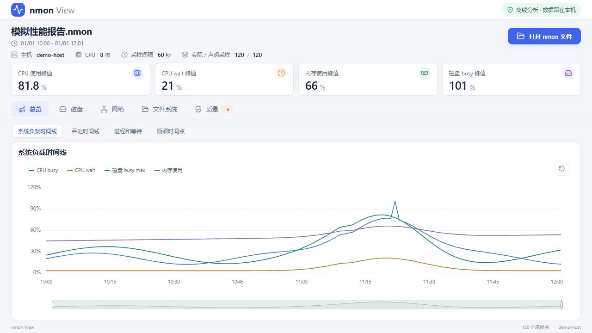
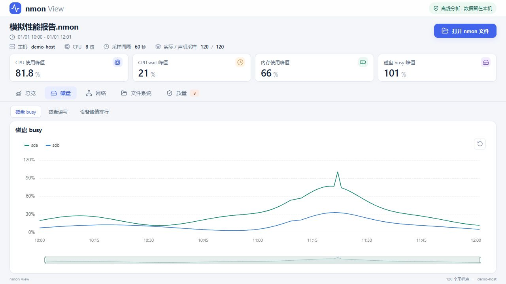
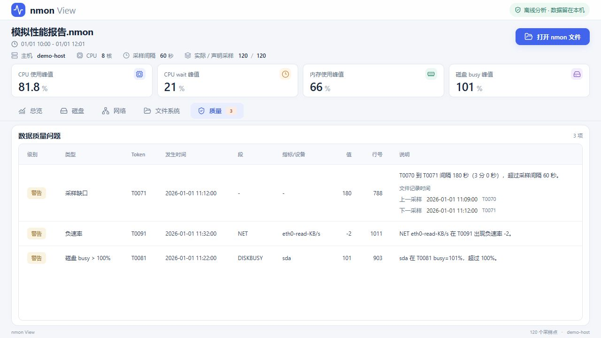

# nmon View

离线 nmon 性能分析工具。`desktop/` 为 Rust + Tauri 2 桌面版；根目录 `src/` 保留浏览器版及解析器。

## 桌面版

- 本地选择或拖入 nmon 文件，查看 CPU、内存、磁盘、网络和文件系统指标。
- 一级与二级页签切换；图表适配窗口，长表格在内容区内滚动。
- 文件在本机解析，不上传监控数据。单文件上限 128 MB。

## 界面预览

以下为桌面版界面的本地浏览器预览截图，使用人工生成的模拟数据，不包含真实主机监控信息。

### 首次打开

欢迎提示居中，可选择文件或将文件拖入桌面窗口开始分析。


### 系统总览

峰值指标与系统负载时间线集中展示，通过二级页签切换吞吐、进程和异常时间点。



### 磁盘分析

对比各设备的 busy 趋势，支持查看磁盘读写与设备峰值排行。



### 数据质量

列出采样缺口、负速率和异常 busy 值，保留文件中的发生时间、Token 与行号，便于回查。



## 下载构建产物

正式版本可从仓库 **Releases** 直接下载安装包和 `SHA256SUMS.txt`，公开仓库无需登录。开发构建仍可从 **Actions → 桌面版多平台打包 → 成功的运行 → Artifacts** 下载，通常需要登录 GitHub。

| 产物 | 内容 |
| --- | --- |
| nmon-view-Windows-x64 | NSIS 安装 EXE、MSI、便携 EXE |
| nmon-view-Linux-x64 | AppImage、DEB、RPM |
| nmon-view-macOS-Apple-Silicon | ARM64 DMG |
| nmon-view-macOS-Intel | x64 DMG |

每份产物附 SHA256 校验值和构建信息，默认保留 30 天。构建失败时不会生成该平台的成功产物。

Windows 需要 WebView2；安装版会在缺少时尝试下载。macOS 最低版本为 12.0，仅使用 ad-hoc 签名，未做 Apple 开发者签名及公证，Gatekeeper 可能拦截。Linux 使用 Ubuntu 22.04 构建，目标发行版须满足 WebKitGTK 4.1 等运行依赖；AppImage 并不保证支持所有发行版。

自动化构建和解析测试不代表完成各平台的图形界面验收。首次交付需验证打开文件、拖拽导入、中文路径与图表缩放。

## 开发与构建

先安装 Node.js 22、Rust stable 和对应平台的 Tauri 2 系统依赖。以下为 Windows CMD 命令：

```cmd
cd desktop
npm ci
npm run desktop:dev
```

本机平台打包：

```cmd
cd desktop
npm run desktop:build
```

提交到 `main` 的桌面相关改动会触发四个平台任务；也可在 Actions 中手动执行 **Run workflow**。推送 `v主版本.次版本.补丁版本` 标签后，四个平台全部构建成功才会自动发布 GitHub Release。标签必须与该提交的 Tauri 版本一致。

也可以手动运行 **发布已验证的桌面安装包**，输入版本标签与此前成功的构建运行 ID，复用已生成的产物。发布前验证四平台任务、源码提交、版本及每个安装包的 SHA256；先上传草稿，全部通过远端校验后公开。已有标签指向其他提交、已发布附件内容不同等情况会报错，不覆盖或移动旧版本。

## 测试数据

仓库仅包含 `desktop/tests/fixtures/synthetic.txt` 人工模拟数据。真实 `.nmon`、预览报告、备份、缓存和本机发布包均排除提交。真实样本对照测试仅在本机文件存在时运行。
